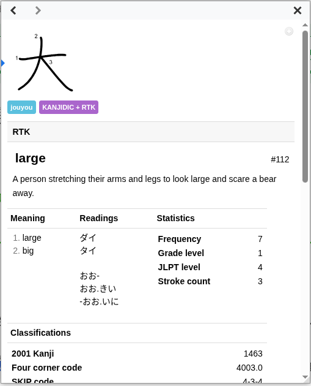

# KANJIDIC + RTK

Build a Yomitan kanji dictionary with RTK keywords, numbers, and mnemonic stories
from `rtk.csv`, followed by the original KANJIDIC English meanings.

Requires Python 3.10 or newer. No dependencies to install.

## RTK section



RTK appears above the meanings, readings, and statistics. The ZIP bundles its
stylesheet as `styles.css`, which Yomitan loads automatically on import. The
screenshot above shows the section in Yomitan; colors and spacing follow your theme.

1. Download `KANJIDIC_RTK_english.zip` from the
   [latest release](https://github.com/dlip/kanjidic-rtk/releases/latest), or build
   the ZIP locally.
2. Import the ZIP in Yomitan's dictionary management page. If you already have
   `KANJIDIC + RTK`, remove that dictionary before importing the rebuilt version.
3. If you previously pasted the separate RTK stylesheet into **Appearance →
   Configure Custom CSS → Popup CSS**, remove that snippet. No manual CSS is needed.

Use the rebuilt dictionary; the original v1.0.0 ZIP does not contain the layout
metadata or bundled stylesheet. The CSS applies only to enriched entries in `KANJIDIC + RTK`.
Entries without RTK data and other dictionaries keep their normal layout.
The RTK text also remains in the underlying meanings for exports. The stylesheet
source is [yomitan-rtk.css](yomitan-rtk.css); rebuild the ZIP after editing it.

## Build

```sh
python3 build.py
```

The command downloads the latest [KANJIDIC English dictionary](https://github.com/yomidevs/jmdict-yomitan)
and writes `dist/KANJIDIC_RTK_english.zip`. Default paths are relative to this
project; explicit paths are relative to your working directory.

To use a previously downloaded dictionary offline or choose different paths:

```sh
python3 build.py --csv rtk.csv --source-zip KANJIDIC_english.zip --output dist/custom.zip
```

In Yomitan's settings, open the dictionary management page and import the generated
ZIP. It appears as `KANJIDIC + RTK`. Disable the original KANJIDIC dictionary if
you only want the combined version displayed. Rebuild and reimport to update it;
automatic upstream updates are disabled for this customized dictionary.

## Releases

Push a new tag to run the release workflow:

```sh
git tag v1.1.0
git push origin v1.1.0
```

The workflow runs the tests, builds the dictionary using the tagged CSV and the
latest upstream KANJIDIC, and publishes a GitHub release with
`KANJIDIC_RTK_english.zip` attached and automatically generated release notes.
All tag names are supported. The workflow uses the built-in `GITHUB_TOKEN`;
no additional secrets are required. The tagged commit must contain the workflow.

## Merge behavior

The input is UTF-8 CSV without a header: `number,kanji,keyword,story`. Quoted
commas and multiline stories are supported. Numbers are optional; when present,
they must be decimal digits. Each kanji field must contain one character.

Matching is by exact kanji character. Every source dictionary entry is retained,
including those without RTK data. Entries with RTK data show text such as:

```text
RTK #1: one
RTK story: One down, 2041 to go. ;).
one
one radical (no.1)
```

Blank fields produce no empty labels. Duplicate CSV rows combine complementary
fields; conflicting records are preserved, with identical RTK display lines
shown once in the text fallback. Readings, existing tags, statistics, and original
meanings are preserved. Additional RTK tags hold the layout fields; the CSS turns
them into the RTK section and hides the duplicate text fallback.
The build reports entries enriched and any CSV kanji absent from KANJIDIC.
Malformed inputs fail without replacing an existing output ZIP.

## Tests

```sh
python3 -m unittest discover -s tests -v
```

Tests use small local fixtures and require no network access.

## Sources and attribution

The source dictionary is built by [yomidevs/jmdict-yomitan](https://github.com/yomidevs/jmdict-yomitan)
from [KANJIDIC](https://www.edrdg.org/wiki/index.php/KANJIDIC_Project).
The generated archive retains the source dictionary's attribution and archive
content. Consult those sources for the dictionary data's license terms.

The provenance and redistribution terms of the supplied `rtk.csv`, including its
mnemonic stories, are unspecified. This project does not assign new license terms
to that data. The repository's code license is in [LICENSE](LICENSE).
